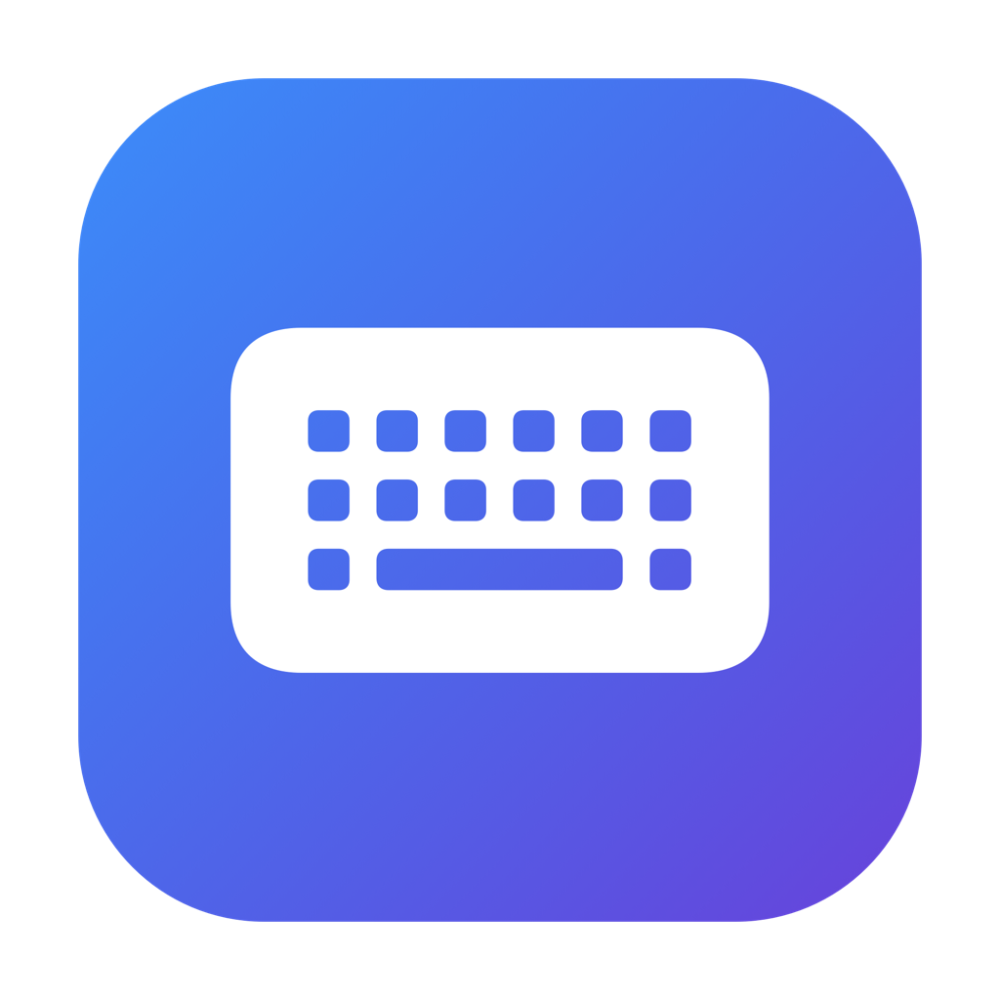

# Magic Keyboard Suite

<p align="center">
  
</p>

<p align="center">
  <strong>Utilitat nativa multiplataforma per a teclats Apple Magic Keyboard a macOS i Windows 11</strong>
</p>

<p align="center">
  <a href="README.md">English</a> •
  <strong>Català</strong> •
  <a href="README.es.md">Español</a> •
  <a href="CONTRIBUTING.md">Contributing</a> •
  <a href="SECURITY.md">Security</a> •
  <a href="LICENSE">GPLv3</a>
</p>

---

**Magic Keyboard Suite** unifica l'experiència del teu **Apple Magic Keyboard** entre **macOS** i **Windows 10/11**: passa el teclat d'un ordinador a un altre sense esforç mantenint exactament la mateixa serigrafia, els símbols de tercer nivell amb `Option (⌥)`, les dreceres amb `Command (⌘)` i les tecles multimèdia.

## Què fa a cada sistema

| Funcionalitat | macOS (`13+`) | Windows (`10/11 x64`) |
| :--- | :---: | :---: |
| **Canvi ràpid per Bluetooth** (Alliberar i Connectar entre Mac i PC) | ✅ | ✅ |
| **Suport per cable USB** (Lightning / USB-C) | ✅ | ✅ |
| **Indicador de bateria en temps real** (`IORegistry` a macOS, PnP/GATT a Windows) | ✅ | ✅ |
| **Filtres de dispositius** (*Només teclats Apple*, *Tots els teclats*, *Tots*) i **Recordar teclats alliberats** | ✅ | ✅ |
| **Accés ràpid a la barra de menús / safata del sistema** i **Obrir a l'inici de sessió** | ✅ | ✅ |
| **17 disposicions oficials d'Apple** (canvi immediat) | ✅ Natiu (`Carbon TIS`) | ✅ Importador Boot Camp (verificat amb Authenticode) |
| **Intercanvi físic ISO** (`[º ª \]` al costat de l'`1`, `[< >]` al costat de `Majúscules` esquerre) | Natiu | ✅ Automàtic |
| **`Option (⌥)` esquerra per a símbols de tercer nivell** (`@ # € [ ] { } \ \| ~`) | Natiu | ✅ Automàtic a les 17 disposicions |
| **Dreceres de Mac, navegació i tecles multimèdia** (`⌘`, `⌥`, `F3–F12`) | Natiu | ✅ Només en maquinari Apple (`VID_05AC` / `004C`) |
| **Interfície nativa multiidioma** (`Català`, `English`, `Español`) i desinstal·lador integrat | ✅ SwiftUI | ✅ WinUI 3 (.NET 8) |

---

## Com funciona el canvi per Bluetooth

Els Apple Magic Keyboard només guarden **un únic aparellament Bluetooth actiu alhora**. Magic Keyboard Suite converteix el canvi entre ordinadors en un procés ràpid i repetible:

1. A l'ordinador actual, prem **Alliberar** a la targeta del teclat (l'app el desconnecta, n'oblida l'aparellament i en recorda l'adreça).
2. Apaga l'interruptor físic del teclat, espera 2 segons i **torna'l a encendre**.
3. A l'altre ordinador, prem **Connectar** (des de la finestra principal, la barra de menús de macOS o la safata del sistema de Windows).

---

## Motor de teclat a Windows

A Windows, un agent lleuger en segon pla (`WH_KEYBOARD_LL` + `RawInput`) aplica el comportament d'Apple **exclusivament a teclats d'Apple** (`VID_05AC` / `004C`), de manera que qualsevol altre teclat connectat manté el seu funcionament normal de Windows (configurable als ajustos):

- **3 modes de modificadors:**
  - **Mode Mac (recomanat):** `⌘ + C/V/X/Z/A/S/F/T/W` (i dreceres habituals d'edició/navegació), `⌘ + Tab` (canviador d'apps persistent mentre mantens `⌘`), `⌘ + Q` (`Alt + F4`) i `⌘ + Espai` (Cerca de Windows, `Win + S`).
  - **Intercanvi total (`⌘ ↔ Ctrl`):** Intercanvia les tecles Command i Control a tots dos costats.
  - **Estàndard Windows (`⌘ = Win`):** Manté el comportament estàndard de Windows.
- **Navegació i esborrat estil Mac:**
  - `⌘ + ← / →` (`Inici / Fi`) i `⌘ + ↑ / ↓` (`RePàg / AvPàg`).
  - `Option (⌥) + ← / →` (saltar paraula) i `Option (⌥) + Retrocés` (esborrar paraula).
  - `Fn + Retrocés` (o `Option dret / Ctrl dret / ⌘ dret + Retrocés`) per a `Supr`.
- **Correcció física ISO i símbols amb `Option (⌥)` esquerra:**
  - Intercanvia automàticament les tecles ISO perquè `[º ª \]` quedi al costat de l'`1` i `[< >]` al costat de `Majúscules` esquerre.
  - `Option (⌥)` esquerra actua dinàmicament com a `AltGr` per als símbols de tercer nivell (`@ # € [ ] { } \ | ~`) en qualsevol de les 17 disposicions d'Apple.
- **Tecles de funció i multimèdia (`F1–F12`):**
  - Permet triar entre tecles multimèdia per defecte (`F3` Vista de tasques, `F4` Cerca, `F5` Dictat, `F7–F9` reproducció, `F10–F12` volum) o tecles `F1–F12` estàndard.

### Limitacions conegudes a Windows

- **Tecla `Fn` física:** Windows bloqueja la tecla `Fn` física del Magic Keyboard en mode usuari si no hi ha un driver de nucli (kernel). Per disposar de totes les funcions d'`Fn` (`Supr`, navegació i `F1–F12`) sense drivers de nucli, activa **Usar `Option (⌥)` dret com a tecla `Fn`** a *Dreceres i multimèdia* (els símbols continuen disponibles amb `Option` esquerra).
- **Finestres d'Administrador (UIPI):** Quan l'agent s'executa sense privilegis d'Administrador i una finestra elevada està en primer pla, Windows bloqueja `SendInput` per UIPI. En aquest cas, l'agent deixa passar les tecles físiques de manera transparent per no bloquejar l'escriptura.

---

## Disposicions oficials d'Apple a Windows (drivers de Boot Camp)

A **macOS** les 17 disposicions ja venen integrades de sèrie. A **Windows**, el canvi per Bluetooth, les dreceres `⌘` i l'intercanvi ISO funcionen des del primer segon amb la disposició estàndard del sistema com a suport. Per tenir **exactament el 100 % de la serigrafia oficial d'Apple** (com ara el punt volat `·` a `Majúscules + 3` i tots els símbols exactes d'`Option`), cal importar les llibreries oficials de **Boot Camp** (no es redistribueixen al repositori per ser programari propietari d'Apple):

1. Baixa el paquet `.zip` oficial de **Boot Camp Support Software** directament des del Suport d'Apple: **[support.apple.com/106378](https://support.apple.com/106378)** *(alternativament, pots obtenir la carpeta amb l'Assistent Boot Camp en un Mac Intel o amb [Brigadier](https://github.com/timsutton/brigadier))*.
2. **Important:** **No descomprimeixis ni executis el `setup.exe` de Boot Camp** en un PC normal amb Windows (aquell instal·lador complet és exclusiu per a ordinadors Mac).
3. Obre **Magic Keyboard Suite** a Windows (a la benvinguda inicial o a la pestanya *Disposició i idioma*), prem **«Triar .zip…»** (o **«Triar carpeta…»** si ja l'has descomprimit) i selecciona el paquet: l'aplicació n'extraurà només les 17 llibreries de teclat (`*A.dll`), en comprovarà la signatura digital Authenticode oficial d'Apple/Microsoft i les instal·larà en segons.

<details>
<summary>Disposicions de teclat Apple compatibles (17)</summary>

- Español / Català (Apple)
- United States (Apple)
- United States-International (Apple)
- United Kingdom (Apple)
- Français (Apple)
- Deutsch (Apple)
- Italiano (Apple)
- Português (Apple)
- Nederlands (Apple)
- Svenska (Apple)
- Dansk (Apple)
- Norsk (Apple)
- Suomi (Apple)
- Swiss (Apple)
- Belgian (Apple)
- Polski (Apple)
- Russian (Apple)

</details>

---

## Descàrrega o compilació des del codi font

### Instal·ladors a punt per utilitzar (GitHub Releases)

- **macOS (`macOS 13+`):** Baixa `MagicKeyboardSuite-macOS.dmg` des de **Releases**.
- **Windows (`Windows 10/11 x64`):** Baixa `MagicKeyboardSuite-Setup.msi` des de **Releases**.

### Compilar des del codi font

Totes dues apps natives comparteixen una única font de veritat per a tokens de disseny, ajustos, disposicions i traduccions a [`shared/`](shared/) (consulta [CONTRIBUTING.md](CONTRIBUTING.md) per a l'arquitectura i els tests).

```bash
# macOS (.app + .dmg) — requereix Xcode Command Line Tools i Python 3
./macos/build.sh --dmg
```

```powershell
# Windows 10/11 x64 (.msi) — requereix .NET 8 SDK, .NET Framework 4.8 targeting pack, WiX v5 i Python 3
powershell -ExecutionPolicy Bypass -File .\windows\build.ps1
```

---

## Avís legal

Projecte independent de codi obert sota llicència [GPLv3](LICENSE). No està afiliat, patrocinat ni avalat per Apple Inc. ni per Microsoft Corporation. *"Apple"*, *"Magic Keyboard"*, *"macOS"* i *"Boot Camp"* són marques registrades d'Apple Inc. *"Windows"* és marca registrada de Microsoft Corporation.
