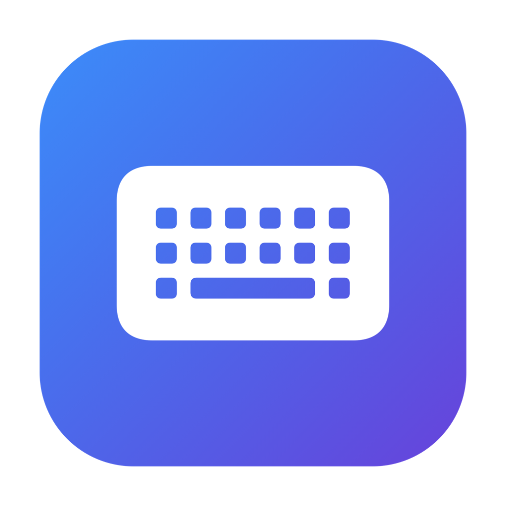

# Magic Keyboard Suite

<p align="center">
  
</p>

<p align="center">
  <strong>Utilidad nativa multiplataforma para teclados Apple Magic Keyboard en macOS y Windows 11</strong>
</p>

<p align="center">
  <a href="README.md">English</a> •
  <a href="README.ca.md">Català</a> •
  <strong>Español</strong> •
  <a href="CONTRIBUTING.md">Contributing</a> •
  <a href="SECURITY.md">Security</a> •
  <a href="LICENSE">GPLv3</a>
</p>

---

**Magic Keyboard Suite** unifica la experiencia de tu **Apple Magic Keyboard** entre **macOS** y **Windows 10/11**: cambia el teclado de un ordenador a otro sin esfuerzo manteniendo exactamente la misma serigrafía, los símbolos de tercer nivel con `Option (⌥)`, los atajos con `Command (⌘)` y las teclas multimedia.

## Qué hace en cada sistema

| Funcionalidad | macOS (`13+`) | Windows (`10/11 x64`) |
| :--- | :---: | :---: |
| **Cambio rápido por Bluetooth** (Liberar y Conectar entre Mac y PC) | ✅ | ✅ |
| **Soporte por cable USB** (Lightning / USB-C) | ✅ | ✅ |
| **Indicador de batería en tiempo real** (`IORegistry` en macOS, PnP/GATT en Windows) | ✅ | ✅ |
| **Filtros de dispositivos** (*Solo teclados Apple*, *Todos los teclados*, *Todos*) y **Recordar teclados liberados** | ✅ | ✅ |
| **Acceso rápido en barra de menús / bandeja del sistema** y **Abrir al iniciar sesión** | ✅ | ✅ |
| **17 disposiciones oficiales de Apple** (cambio inmediato) | ✅ Nativo (`Carbon TIS`) | ✅ Importador Boot Camp (verificado con Authenticode) |
| **Intercambio físico ISO** (`[º ª \]` junto al `1`, `[< >]` junto a `Mayús` izquierdo) | Nativo | ✅ Automático |
| **`Option (⌥)` izquierda para símbolos de tercer nivel** (`@ # € [ ] { } \ \| ~`) | Nativo | ✅ Automático en las 17 disposiciones |
| **Atajos de Mac, navegación y teclas multimedia** (`⌘`, `⌥`, `F3–F12`) | Nativo | ✅ Solo en hardware Apple (`VID_05AC` / `004C`) |
| **Interfaz nativa multiidioma** (`Español`, `Català`, `English`) y desinstalador integrado | ✅ SwiftUI | ✅ WinUI 3 (.NET 8) |

---

## Cómo funciona el cambio por Bluetooth

Los Apple Magic Keyboard solo guardan **un único emparejamiento Bluetooth activo a la vez**. Magic Keyboard Suite convierte el cambio entre ordenadores en un proceso rápido y repetible:

1. En el equipo actual, pulsa **Liberar** en la tarjeta del teclado (la app lo desconecta, olvida el emparejamiento y recuerda su dirección).
2. Apaga el interruptor físico del teclado, espera 2 segundos y **vuélvelo a encender**.
3. En el otro equipo, pulsa **Conectar** (desde la ventana principal, la barra de menús de macOS o la bandeja del sistema de Windows).

---

## Motor de teclado en Windows

En Windows, un agente ligero en segundo plano (`WH_KEYBOARD_LL` + `RawInput`) aplica el comportamiento de Apple **exclusivamente a teclados de Apple** (`VID_05AC` / `004C`), de modo que cualquier otro teclado conectado mantiene su comportamiento estándar de Windows (configurable en los ajustes):

- **3 modos de modificadores:**
  - **Modo Mac (recomendado):** `⌘ + C/V/X/Z/A/S/F/T/W` (y atajos habituales de edición/navegación), `⌘ + Tab` (selector de apps persistente mientras mantienes `⌘`), `⌘ + Q` (`Alt + F4`) y `⌘ + Espacio` (Búsqueda de Windows, `Win + S`).
  - **Intercambio total (`⌘ ↔ Ctrl`):** Intercambia las teclas Command y Control en ambos lados.
  - **Estándar Windows (`⌘ = Win`):** Mantiene el comportamiento estándar de Windows.
- **Navegación y borrado estilo Mac:**
  - `⌘ + ← / →` (`Inicio / Fin`) y `⌘ + ↑ / ↓` (`RePág / AvPág`).
  - `Option (⌥) + ← / →` (saltar palabra) y `Option (⌥) + Retroceso` (borrar palabra).
  - `Fn + Retroceso` (o `Option derecho / Ctrl derecho / ⌘ derecho + Retroceso`) para `Supr`.
- **Corrección física ISO y símbolos con `Option (⌥)` izquierda:**
  - Intercambia automáticamente las teclas ISO para que `[º ª \]` quede junto al `1` y `[< >]` junto a `Mayús` izquierdo.
  - `Option (⌥)` izquierda actúa dinámicamente como `AltGr` para los símbolos de tercer nivel (`@ # € [ ] { } \ | ~`) en cualquiera de las 17 disposiciones de Apple.
- **Teclas de función y multimedia (`F1–F12`):**
  - Permite alternar entre teclas multimedia por defecto (`F3` Vista de tareas, `F4` Búsqueda, `F5` Dictado, `F7–F9` reproducción, `F10–F12` volumen) o teclas `F1–F12` estándar.

### Limitaciones conocidas en Windows

- **Tecla `Fn` física:** Windows bloquea la tecla `Fn` física del Magic Keyboard en modo usuario sin un controlador de núcleo (kernel). Para disponer de todas las funciones de `Fn` (`Supr`, navegación y `F1–F12`) sin drivers de kernel, activa **Usar `Option (⌥)` derecho como tecla `Fn`** en *Atajos y multimedia* (los símbolos siguen disponibles con `Option` izquierda).
- **Ventanas de Administrador (UIPI):** Cuando el agente se ejecuta sin privilegios de Administrador y una ventana elevada está en primer plano, Windows bloquea `SendInput` por UIPI. En ese caso, el agente deja pasar las teclas físicas de forma transparente para no bloquear la escritura.

---

## Disposiciones oficiales de Apple en Windows (drivers de Boot Camp)

En **macOS** las 17 disposiciones ya vienen incluidas de serie. En **Windows**, el cambio por Bluetooth, los atajos `⌘` y el intercambio ISO funcionan desde el primer segundo usando las disposiciones estándar de Windows como respaldo. Para tener **exactamente el 100 % de la serigrafía oficial de Apple** (por ejemplo el punto volado `·` en `Mayús + 3` y todos los caracteres terciarios exactos), conviene importar las librerías oficiales de **Boot Camp** (no se redistribuyen en el repositorio por ser software propietario de Apple):

1. Descarga el paquete `.zip` oficial de **Boot Camp Support Software** directamente desde Soporte de Apple: **[support.apple.com/106378](https://support.apple.com/106378)** *(también puedes obtener la carpeta desde el Asistente Boot Camp en un Mac Intel o con [Brigadier](https://github.com/timsutton/brigadier))*.
2. **Importante:** **No descomprimas ni ejecutes el `setup.exe` de Boot Camp** en un PC normal con Windows (ese instalador completo es solo para ordenadores Mac).
3. Abre **Magic Keyboard Suite** en Windows (en la pantalla de bienvenida o en la pestaña *Disposición e idioma*), pulsa **«Elegir .zip…»** (o **«Elegir carpeta…»** si ya lo has descomprimido) y selecciona el paquete: la aplicación extraerá únicamente las 17 librerías de teclado (`*A.dll`), verificará su firma digital Authenticode oficial de Apple/Microsoft y las instalará en segundos.

<details>
<summary>Disposiciones de teclado Apple compatibles (17)</summary>

- Español / Català (Apple)
- United States (Apple)
- United States-International (Apple)
- United Kingdom (Apple)
- Français (Apple)
- Deutsch (Apple)
- Italiano (Apple)
- Português (Apple)
- Nederlands (Apple)
- Svenska (Apple)
- Dansk (Apple)
- Norsk (Apple)
- Suomi (Apple)
- Swiss (Apple)
- Belgian (Apple)
- Polski (Apple)
- Russian (Apple)

</details>

---

## Descarga o compilación desde el código fuente

### Instaladores listos para usar (GitHub Releases)

- **macOS (`macOS 13+`):** Descarga `MagicKeyboardSuite-macOS.dmg` desde **Releases**.
- **Windows (`Windows 10/11 x64`):** Descarga `MagicKeyboardSuite-Setup.msi` desde **Releases**.

### Compilar desde el código fuente

Ambas apps nativas comparten una fuente única de verdad para tokens de diseño, ajustes, disposiciones y traducciones en [`shared/`](shared/) (consulta [CONTRIBUTING.md](CONTRIBUTING.md) para ver la arquitectura y las pruebas).

```bash
# macOS (.app + .dmg) — requiere Xcode Command Line Tools y Python 3
./macos/build.sh --dmg
```

```powershell
# Windows 10/11 x64 (.msi) — requiere .NET 8 SDK, .NET Framework 4.8 targeting pack, WiX v5 y Python 3
powershell -ExecutionPolicy Bypass -File .\windows\build.ps1
```

---

## Aviso legal

Proyecto independiente de código abierto bajo licencia [GPLv3](LICENSE). No está afiliado, patrocinado ni avalado por Apple Inc. ni por Microsoft Corporation. *"Apple"*, *"Magic Keyboard"*, *"macOS"* y *"Boot Camp"* son marcas registradas de Apple Inc. *"Windows"* es marca registrada de Microsoft Corporation.
