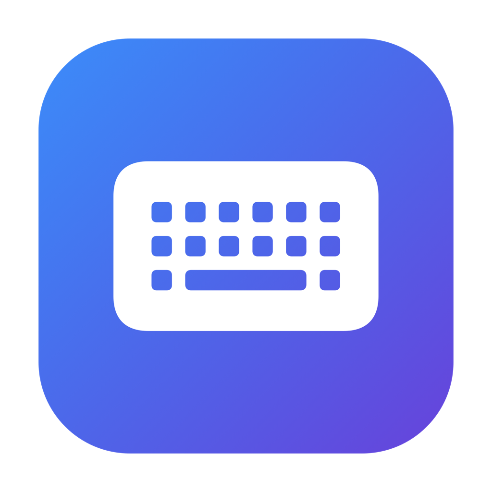

# Magic Keyboard Suite

<p align="center">
  
</p>

<p align="center">
  <strong>Cross-platform native utility for Apple Magic Keyboards on macOS &amp; Windows 11</strong>
</p>

<p align="center">
  <strong>English</strong> •
  <a href="README.ca.md">Català</a> •
  <a href="README.es.md">Español</a> •
  <a href="CONTRIBUTING.md">Contributing</a> •
  <a href="SECURITY.md">Security</a> •
  <a href="LICENSE">GPLv3</a>
</p>

---

**Magic Keyboard Suite** unifies your **Apple Magic Keyboard** experience across **macOS** and **Windows 10/11**: move your keyboard between Mac and PC effortlessly while keeping identical keycap mapping, `Option (⌥)` third-level symbols, `Command (⌘)` shortcuts, and media keys.

## What it does on each platform

| Feature | macOS (`13+`) | Windows (`10/11 x64`) |
| :--- | :---: | :---: |
| **Bluetooth handover** (Release & Connect between Mac and PC) | ✅ | ✅ |
| **USB support** (Lightning / USB-C wired mode) | ✅ | ✅ |
| **Live battery level badge** (`IORegistry` on macOS, PnP/GATT on Windows) | ✅ | ✅ |
| **Device filters** (*Apple keyboards only*, *All keyboards*, *All devices*) & **Remember released keyboards** | ✅ | ✅ |
| **Menu bar / System tray quick controls** & **Open at login** | ✅ | ✅ |
| **17 official Apple layouts** (instant switching) | ✅ Native (`Carbon TIS`) | ✅ Boot Camp importer (Authenticode-verified) |
| **ISO key swap** (`[º ª \]` next to `1`, `[< >]` next to left `Shift`) | Native | ✅ Automatic |
| **Left `Option (⌥)` for third-level symbols** (`@ # € [ ] { } \ \| ~`) | Native | ✅ Automatic across all 17 layouts |
| **Mac shortcuts, navigation & media keys** (`⌘`, `⌥`, `F3–F12`) | Native | ✅ Scoped to Apple hardware (`VID_05AC` / `004C`) |
| **Multi-language native UI** (`English`, `Català`, `Español`) & built-in uninstaller | ✅ SwiftUI | ✅ WinUI 3 (.NET 8) |

---

## How Bluetooth switching works

Apple Magic Keyboards only keep **one active Bluetooth pairing at a time**. Magic Keyboard Suite streamlines moving between computers into a fast, repeatable flow:

1. On your current computer, click **Release** on your keyboard's card (the app disconnects, forgets the pairing, and remembers the keyboard's address).
2. Turn the keyboard's physical power switch **off**, wait 2 seconds, and turn it **back on**.
3. On your other computer, click **Connect** (from the main window, the macOS menu bar, or the Windows system tray).

---

## Keyboard engine on Windows

On Windows, a lightweight background agent (`WH_KEYBOARD_LL` + `RawInput`) applies Apple-accurate behavior **exclusively to Apple keyboards** (`VID_05AC` / `004C`), so any other connected keyboard keeps its standard Windows behavior (configurable in settings):

- **3 modifier modes:**
  - **Mac mode (recommended):** `⌘ + C/V/X/Z/A/S/F/T/W` (and standard editing/browser shortcuts), `⌘ + Tab` (persistent app switcher while holding `⌘`), `⌘ + Q` (`Alt + F4`), and `⌘ + Space` (Windows Search, `Win + S`).
  - **Full swap (`⌘ ↔ Ctrl`):** Swaps both left and right Command and Control keys.
  - **Windows standard (`⌘ = Win`):** Keeps standard Windows modifier behavior.
- **Mac-style navigation & deletion:**
  - `⌘ + ← / →` (`Home / End`) and `⌘ + ↑ / ↓` (`Page Up / Page Down`).
  - `Option (⌥) + ← / →` (word-by-word navigation) and `Option (⌥) + Backspace` (delete word).
  - `Fn + Backspace` (or `Right Option / Right Ctrl / Right ⌘ + Backspace`) for Forward `Delete`.
- **ISO physical key fix & Left `Option (⌥)` symbols:**
  - Automatically swaps the ISO keys so `[º ª \]` sits next to `1` and `[< >]` sits next to left `Shift`.
  - Left `Option (⌥)` dynamically acts as `AltGr` for third-level symbols (`@ # € [ ] { } \ | ~`) across all 17 Apple layouts.
- **Function & media keys (`F1–F12`):**
  - Supports toggling media keys as default (`F3` Task View, `F4` Search, `F5` Dictation, `F7–F9` media playback, `F10–F12` volume) vs. standard `F1–F12` keys.

### Known Windows limitations

- **Physical `Fn` key:** Windows blocks the Magic Keyboard's physical `Fn` key in user mode without a kernel driver. To get full `Fn` functionality (`Delete`, navigation, and `F1–F12`) without installing a kernel driver, enable **Use Right Option (`⌥`) as `Fn` key** in *Shortcuts & media* (third-level symbols remain available via Left `Option`).
- **Administrator / elevated windows (UIPI):** When the background agent runs without Administrator privileges and an elevated window is focused, Windows blocks `SendInput` via UIPI. In that case, the agent transparently passes physical keystrokes through instead of swallowing them.

---

## Official Apple keyboard layouts on Windows (Boot Camp drivers)

On **macOS**, all 17 Apple layouts are built into the OS. On **Windows**, Bluetooth handover, `⌘` shortcuts, and ISO key swapping work right out of the box using Windows' built-in layouts as a fallback. To get **100% keycap-accurate Apple mappings** (for example, the Catalan middle dot `·` on `Shift + 3` and every exact `Option` symbol), import Apple's official **Boot Camp** keyboard layout DLLs (not bundled in this repository because they are proprietary Apple software):

1. Download the official **Boot Camp Support Software** `.zip` package directly from Apple Support: **[support.apple.com/106378](https://support.apple.com/106378)** *(alternatively, obtain a Boot Camp folder via Boot Camp Assistant on an Intel Mac or [Brigadier](https://github.com/timsutton/brigadier))*.
2. **Important:** **Do NOT unzip or run Boot Camp's `setup.exe`** on a standard Windows PC (that full installer is meant only for Mac hardware).
3. Open **Magic Keyboard Suite** on Windows (during initial onboarding or in the *Layout & language* tab), click **“Select .zip…”** (or **“Select folder…”** if already extracted), and pick the downloaded package: the app extracts only the 17 keyboard layout files (`*A.dll`), verifies their official Apple/Microsoft Authenticode digital signature, and registers them in seconds.

<details>
<summary>Supported Apple keyboard layouts (17)</summary>

- Español / Català (Apple)
- United States (Apple)
- United States-International (Apple)
- United Kingdom (Apple)
- Français (Apple)
- Deutsch (Apple)
- Italiano (Apple)
- Português (Apple)
- Nederlands (Apple)
- Svenska (Apple)
- Dansk (Apple)
- Norsk (Apple)
- Suomi (Apple)
- Swiss (Apple)
- Belgian (Apple)
- Polski (Apple)
- Russian (Apple)

</details>

---

## Download or build from source

### Ready-to-use installers (GitHub Releases)

- **macOS (`macOS 13+`):** Download `MagicKeyboardSuite-macOS.dmg` from **Releases**.
- **Windows (`Windows 10/11 x64`):** Download `MagicKeyboardSuite-Setup.msi` from **Releases**.

### Build from source

Both native apps share a single source of truth for design tokens, settings, layouts, and translations in [`shared/`](shared/) (see [CONTRIBUTING.md](CONTRIBUTING.md) for architecture details and tests).

```bash
# macOS (.app + .dmg) — requires Xcode Command Line Tools & Python 3
./macos/build.sh --dmg
```

```powershell
# Windows 10/11 x64 (.msi) — requires .NET 8 SDK, .NET Framework 4.8 targeting pack, WiX v5 & Python 3
powershell -ExecutionPolicy Bypass -File .\windows\build.ps1
```

---

## Disclaimer

Independent open-source project licensed under [GPLv3](LICENSE). Not affiliated with, sponsored by, or endorsed by Apple Inc. or Microsoft Corporation. *"Apple"*, *"Magic Keyboard"*, *"macOS"*, and *"Boot Camp"* are registered trademarks of Apple Inc. *"Windows"* is a registered trademark of Microsoft Corporation.
